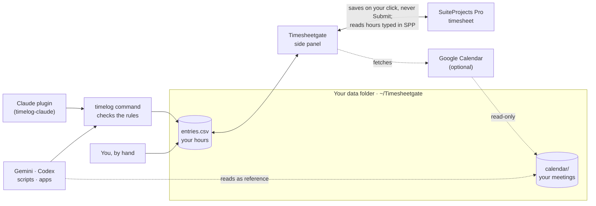

# Timesheetgate — Make Minutes Multiply

Stop clicking through SuiteProjects Pro (SPP) timesheets. Keep your hours in a plain local
file, let Claude (or any agent, script or app) maintain it, and sync it into SPP with one
click.

- **Never submits.** It only saves; "Save & Submit" stays yours. A test enforces this.
- **Local first.** Your hours live in `entries.csv` in a folder you choose (suggested:
  `~/Timesheetgate`). No server, no external service, no API key.
- **Nothing to install but the extension.** The side panel reads and writes the folder
  directly (Chrome's File System Access API). No admin rights; macOS and Windows.
- **Any SPP account.** Works on whichever `*.netsuitesuiteprojectspro.com` timesheet is open
  in Chrome, with your normal login.

## How it fits together



| Part | Folder | What it does |
|---|---|---|
| Chrome extension | `extension/` | Side panel next to the SPP timesheet: shows the week, edits cells, enters PTO, syncs |
| `timelog` command | `cli/` | Optional. The one interface for agents, scripts and apps; checks every rule before it writes. Installed by `host/install.sh` |
| Calendar script | `calendar/` | Optional. Apps Script that returns your meetings to the panel, read-only (see below) |
| Agent guide | `host/AGENTS.md` | Rules for any AI agent or person editing `entries.csv` |

The Claude Code plugin is a separate repo, [timelog-claude](https://github.com/sedojj/timelog-claude):
it logs which client each chat worked on and runs the daily review — through the `timelog`
command, like any other client.

## Install

Needs Google Chrome (and Node.js to build the extension).

1. **Build the extension**
   ```bash
   cd extension && npm ci && npm run build
   ```
2. **Load it:** `chrome://extensions` → turn on *Developer mode* → *Load unpacked* →
   choose `extension/dist`.
3. **Choose the data folder:** open an SPP timesheet, click the toolbar icon, then
   **Choose folder**. Create a folder named `Timesheetgate` in your home folder — the
   `timelog` command and the Claude plugin use `~/Timesheetgate` by default. Change it under ⚙.
   **Then, once:** click **Keep access** in the panel's yellow bar (or open
   `chrome-extension://<extension id>/sidepanel/sidepanel.html` in a tab), click in that tab and
   choose **Allow on every visit**. Without it Chrome drops the access a few seconds after each
   click, and the panel asks for a click before it can read the file again.
4. **Optional, the `timelog` command** (for agents, scripts and the Claude plugin; needs
   Python 3; macOS and Linux):
   ```bash
   sh host/install.sh
   ```
   It installs `timelog` in `~/.local/bin` and copies the agent guide to
   `~/Timesheetgate/AGENTS.md`. An old `~/.timelog` folder moves to `~/Timesheetgate` once.
   **If you chose another folder in the panel**, set `TIMELOG_HOME` to it (for example in
   `~/.zshrc`: `export TIMELOG_HOME="$HOME/Documents/Timesheets"`), then run the installer.
5. **Optional, for Claude Code users:** install
   [timelog-claude](https://github.com/sedojj/timelog-claude).

After a code change: `npm run build` in `extension/`, then reload the extension in
`chrome://extensions`.

### Optional: your Google Calendar

The panel can save your meetings into the data folder (`calendar/<Sunday>.json`, one file per
SPP week), so agents can suggest entries from them. It reads through a small Apps Script that
runs under your own Google account, so no Google Cloud project is needed.

1. Open [script.google.com](https://script.google.com) → **New project**.
2. ⚙ **Project Settings** → tick **Show "appsscript.json" manifest file in editor**. Replace
   `appsscript.json` and `Code.gs` with the files in [`calendar/`](calendar/). The manifest
   limits the script to read-only calendar access.
3. **Deploy** → **New deployment** → ⚙ → **Web app**: *Execute as* **Me**, *Who has access*
   **Only myself** → **Deploy**, and allow the access ("See and download any calendar…").
4. Copy the **Web app URL** (ends with `/exec`) into the panel: ⚙ → *Calendar script address*
   → **Save address**.

The panel fetches the open timesheet's week (or this week) when it opens, and when you click
**Refresh calendar** at the top of the panel, next to the time of the last fetch. It uses your
Google login in Chrome. After you change the script: **Deploy** → **Manage deployments** → ✎ →
*Version*: **New version** (not the existing one); the URL stays.

**Public holidays.** The script also reads the public-holiday calendars in your Google
Calendar list (Google adds your country's one by default; more under *Other calendars* →
*Browse calendars of interest*). A day off shows in the grid header with its flag, e.g.
"Tue 17 🇨🇿🎉". One click on it enters 8 h on your `holiday` line, with the description
"Public holiday CZ" and the holiday's name as the note. Set that line once:
`timelog alias set holiday --project "…" --task "…" --time-type "…"` (for example your time-off
project's company-holiday task). Nothing is entered without your click.

## Daily use

1. **Log hours** any way you like:
   - in Claude: "log 1.5 h to acme", or "review today" at the end of the day;
   - with the command: `timelog add --alias acme --task "…" --hours 1.5 --description "…" --note "…"`;
   - in the side panel: click a cell and type, or use **Enter PTO**;
   - with another agent: tell it to read `~/Timesheetgate/AGENTS.md` first.
2. **Open the week** in SPP and click the toolbar icon. The panel shows each cell's state and
   "What Sync will do". It updates by itself.
3. **Click Sync.** Your changes go to SPP, hours typed by hand in SPP come back to your file,
   and cells changed on both sides ask you to choose.
4. **Submit in SPP** when the week is complete.

## Rules SPP enforces (the tools check them for you)

- Project, task and time type must match SPP's names exactly. The extension keeps the list in
  `projects.json` (⚙ → *Sync project list*).
- Every hour entry needs a description **and** a note; SPP rejects the whole save otherwise.
- Hours in half-hour steps; SPP rounds anything else.
- A submitted or approved week is locked; the panel shows it and writes nothing.

## Data in `~/Timesheetgate/` (or the folder you chose)

| File | Contents |
|---|---|
| `entries.csv` | Your hour entries: `id,date,project,task,time_type,hours,description,note` |
| `projects.json` | Your SPP projects, tasks and allowed time types |
| `mapping.json` | Aliases ("acme", "pto") |
| `config.json` | Optional: `hour_step` (default 0.5) |
| `spp-state.json` | What SPP held at the last Sync |
| `calendar/<Sunday>.json` | Optional: your meetings of that SPP week, as last fetched |
| `claude/` | Claude Code activity (timelog-claude plugin only) |
| `AGENTS.md` | The agent guide |

Nothing here is sent anywhere except into your own SPP timesheet.

## Limits

- Sync adds at most one *new* timesheet line per click; the panel says when to click again.
- PTO ranges stay within the open week (SPP keeps one timesheet per week).
- The `timelog` command installer is for macOS and Linux; on Windows run
  `python cli/timelog.py` directly. The extension itself works on both.
- The side panel assumes it sits right of the page: ← means "to SPP".

## Development

```bash
cd extension && npm test && npx tsc --noEmit   # extension: vitest + types
python3 -m pytest -q                          # CLI, store and installer (from the repo root)
node extension/icons/render.js                # re-render the icon PNGs from icon.svg
```

Design and findings about the SPP page: [docs/design.md](docs/design.md).
The `recorder/` extension is the throwaway tool used to learn how SPP saves.
